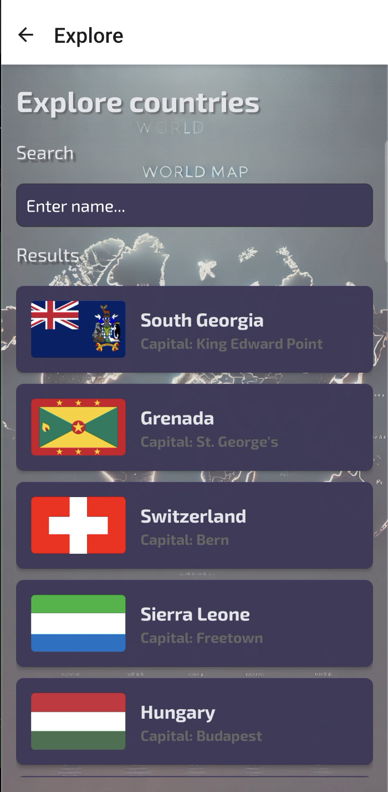
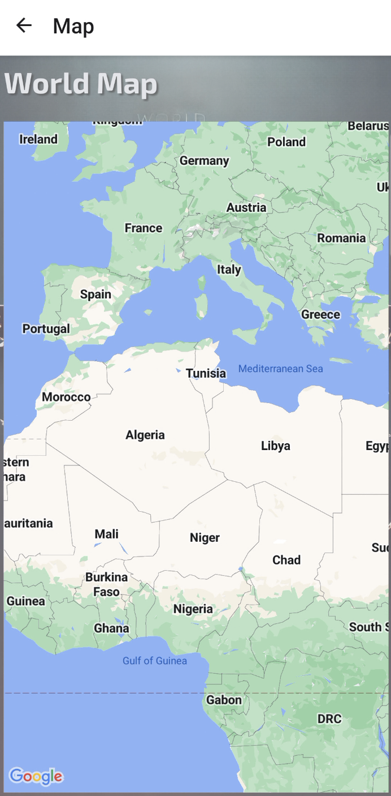
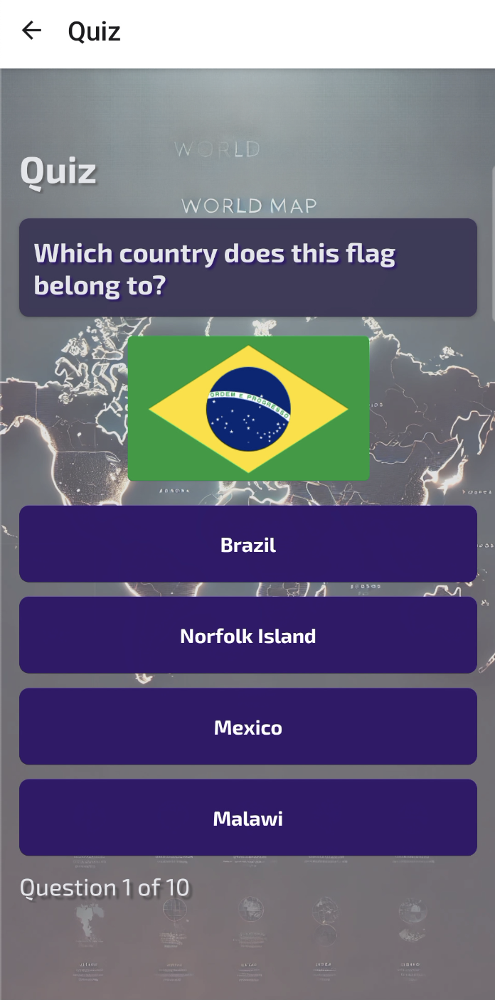
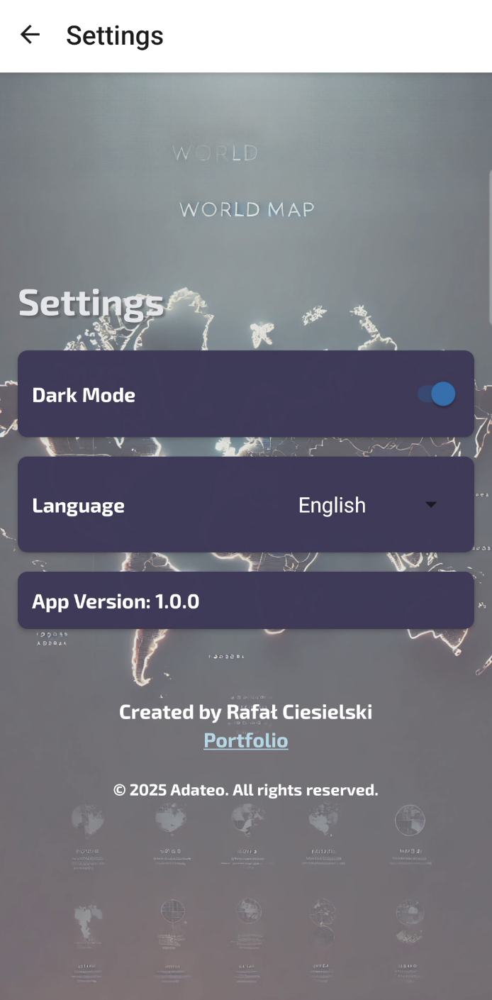

# WorldExplorer

[](https://github.com/rciesielski3/WorldExplorer/actions/workflows/pr-validate.yml)

[](https://play.google.com/store/apps/details?id=com.adateo.WorldExplorer)

An Android app for exploring countries, capitals, flags and geography, built with React Native and Expo. Published on Google Play; current version in this repo: 2.1.1.

## Screenshots

<p>
  
  
  
  
</p>

## Features

- **Explore**: searchable country list with locally bundled flags, capitals and country details; filtering and sorting.
- **Map**: interactive world map (`react-native-maps`).
- **Quiz**: quiz sessions with difficulty levels, results and quiz statistics history.
- **Daily challenge**: a country of the day.
- **Favorites and comparison**: save countries and compare them side by side.
- **Settings**: light/dark theme, language (English, German, Spanish, French, Polish), notification settings.
- **Monetization**: AdMob banner ads and an optional premium entitlement via RevenueCat.

## Tech stack

- React Native 0.79, Expo SDK 53, React 19, TypeScript
- React Navigation, React Native Paper, Reanimated, Lottie
- i18next / react-i18next for localization
- Firebase (Firestore) for historical facts and favorites sync
- Jest and React Native Testing Library for tests
- GitHub Actions for validation, AAB builds and Google Play deployment

## Running locally

```bash
npm install
cp .env.example .env   # then fill in your own values; never commit .env
npm start              # expo start --dev-client
npm run android        # build and run on a connected device/emulator
npm test               # Jest test suite
```

The app uses a development client (`expo start --dev-client`), so it needs a native build (`npm run android`) rather than Expo Go. `.env.example` lists the variables used for Google Maps, Firebase, AdMob and RevenueCat; the app needs your own keys for these services. See [docs/FIREBASE_SETUP.md](docs/FIREBASE_SETUP.md) and [EAS_SECRETS_SETUP.md](EAS_SECRETS_SETUP.md) for details.

## Release notes

See [RELEASE_NOTES.md](RELEASE_NOTES.md). There is no separate CHANGELOG file.

## Building & Deployment

### Build Android Bundle (Dry Run, No Upload)

Generate a signed AAB artifact without uploading to Play Store. `dry_run` defaults to true, so this is what you get unless you pass `-f dry_run=false`.

```bash
gh workflow run deploy-playstore.yml --ref main -f dry_run=true -f track=internal
```

Artifact available on the run page under Artifacts (14-day retention).

---

### Deploy to Play Store

Build and upload AAB to Google Play Store. A real publish requires `-f dry_run=false` and the `main` ref.

**Internal Testing Track:**

```bash
gh workflow run deploy-playstore.yml --ref main \
  -f dry_run=false \
  -f track=internal \
  -f release_notes="v1.3.0 - Testing"
```

**Beta Track:**

```bash
gh workflow run deploy-playstore.yml --ref main \
  -f dry_run=false \
  -f track=beta \
  -f release_notes="v1.3.0 - Beta release"
```

**Production Release:**

```bash
gh workflow run deploy-playstore.yml --ref main \
  -f dry_run=false \
  -f track=production \
  -f release_notes="v1.3.0 - Official release"
```

---

## Workflows

One release workflow manages build and deployment:

1. **deploy-playstore.yml** - Build, verify and deploy to Play Store (`dry_run` builds only)

For detailed workflow documentation, see [.github/WORKFLOWS.md](.github/WORKFLOWS.md).

---

## Requirements

- Node.js 18+
- Android SDK (configured via CI)
- GitHub secrets for Play Store deployment (see [.github/WORKFLOWS.md](.github/WORKFLOWS.md))
